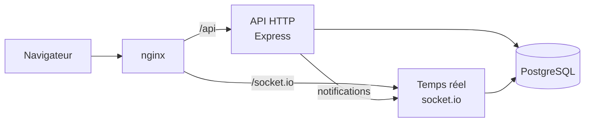

# CollaDoc: Nos choix d'architecture

CollaDoc est un éditeur de documents collaboratif en temps réel, écrit en TypeScript de bout en bout (Vue 3 + Quasar côté client, Node.js côté serveur, PostgreSQL) et lancé avec Docker Compose.

## Deux serveurs, deux métiers

Le sujet imposait deux serveurs. Plutôt que de lancer deux copies du même serveur, on a séparé les rôles : l'API HTTP s'occupe de tout ce qui marche en requête/réponse (comptes, connexion, dossiers, fichiers, partage), et le serveur WebSocket s'occupe de l'édition en direct et des appels. La raison est simple : notre OT a besoin d'un seul serveur qui décide de l'ordre des modifications d'un document. Avec deux copies, il aurait fallu ajouter Redis et un routage par document, ce qui est beaucoup de travail pour rien à notre échelle.

nginx sert de porte d'entrée unique, ce qui permet au cookie de session d'arriver sur les deux serveurs sans avoir à configurer CORS. Les deux serveurs partagent la même base. Quand une action côté API doit avoir un effet immédiat (un compte bloqué, un document supprimé, un rôle changé), l'API prévient le serveur temps réel par une route interne protégée par un secret.

## L'OT fait maison

On a écrit notre propre algorithme d'Operational Transformation (`shared/ot/`) au lieu de prendre Yjs, parce que c'était tout l'intérêt du projet. Le même code tourne dans le navigateur et sur le serveur. Le serveur fait autorité : il numérote chaque modification, et si un client envoie une modification basée sur une version dépassée, il l'adapte à ce qui s'est passé entre-temps avant de la diffuser. Pour garder les choses simples, chaque client n'envoie qu'une modification à la fois et accumule ses frappes en attendant la réponse.

Pour ne rien perdre, chaque modification est enregistrée en base avant d'être confirmée, et le texte complet est sauvegardé régulièrement (toutes les 50 modifications, toutes les 10 secondes, et quand le dernier utilisateur ferme le document). Après une coupure, le client rattrape ce qu'il a manqué et renvoie ce qui n'était pas parti.

## Authentification

On a préféré des sessions en base à des JWT : pour déconnecter quelqu'un ou bloquer un compte, il suffit de supprimer la session, et l'effet est immédiat sur les deux serveurs. Le jeton est dans un cookie `httpOnly` et la base n'en garde que l'empreinte. Les mots de passe sont hachés avec argon2 et les tentatives de connexion sont limitées. Pour le MFA (codes TOTP), le mot de passe seul ne donne qu'une session temporaire qui permet uniquement de saisir le code ; une fois le code validé, on crée une nouvelle session.

## Permissions

L'admin gère les comptes et rien d'autre : il n'a aucun accès aux documents des autres. Sur chaque document, on est propriétaire, éditeur ou lecteur :

| Rôle         | Lire | Modifier | Partager, déplacer, supprimer |
| ------------ | :--: | :------: | :---------------------------: |
| Propriétaire |  ✅  |    ✅    |              ✅               |
| Éditeur      |  ✅  |    ✅    |              ❌               |
| Lecteur      |  ✅  |    ❌    |              ❌               |

On partage un document avec un lien d'invitation valable une heure. Ce lien est signé par le serveur et contient lui-même le document et le rôle, donc il n'y a rien à stocker en base (en contrepartie, on ne peut pas l'annuler avant qu'il expire). Les droits sont toujours vérifiés côté serveur, y compris à chaque frappe sur le serveur temps réel. Quelqu'un qui n'a pas accès à un document reçoit une erreur 404, comme si le document n'existait pas.

## Appels audio

Les appels passent par WebRTC : le son va directement d'un navigateur à l'autre, et notre serveur temps réel sert seulement à les mettre en relation. Les deux personnes doivent avoir accès au document et l'avoir ouvert en même temps. Rien n'est stocké en base.

## Organisation

Une issue GitHub par tâche, une branche par issue, et une pull request pour revenir sur `main`. Les grandes décisions ont été écrites avant de coder, pour que tout le monde parte des mêmes règles. Prettier et la vérification des types sont communs à toute l'équipe, et on a testé en priorité la logique métier, à commencer par l'OT.
